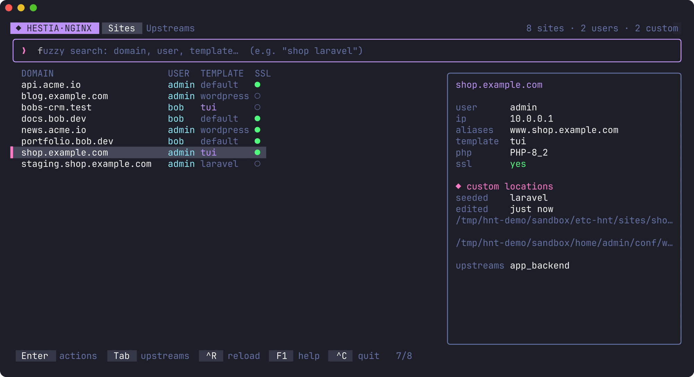
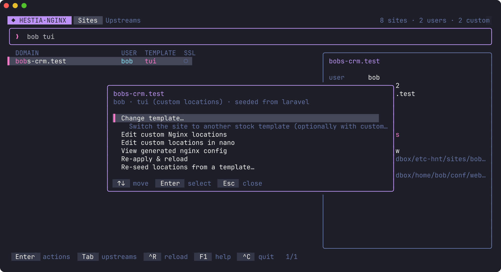
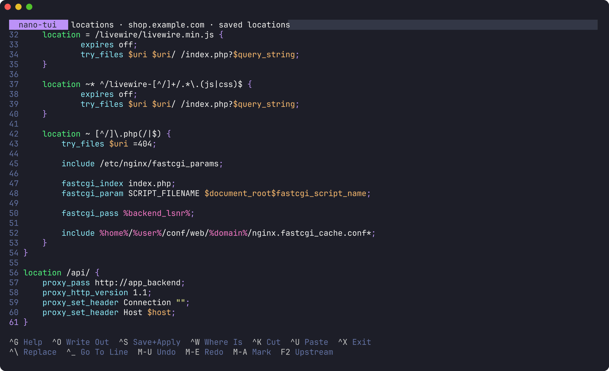
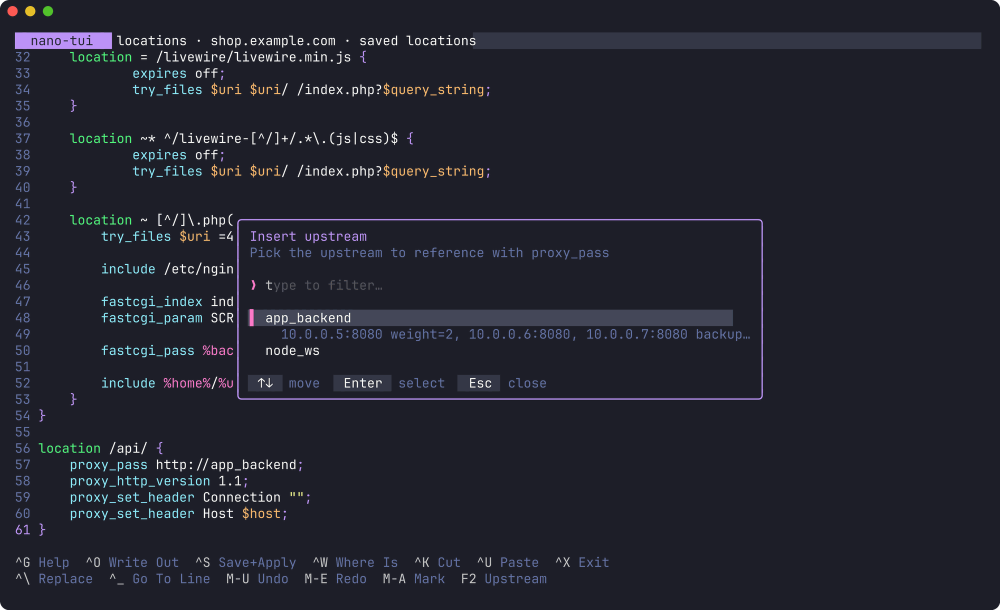
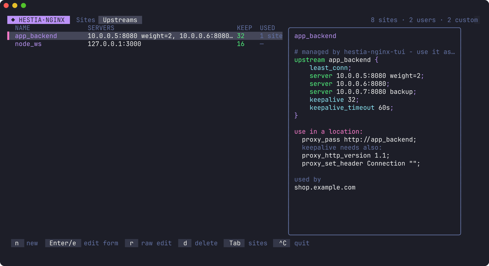
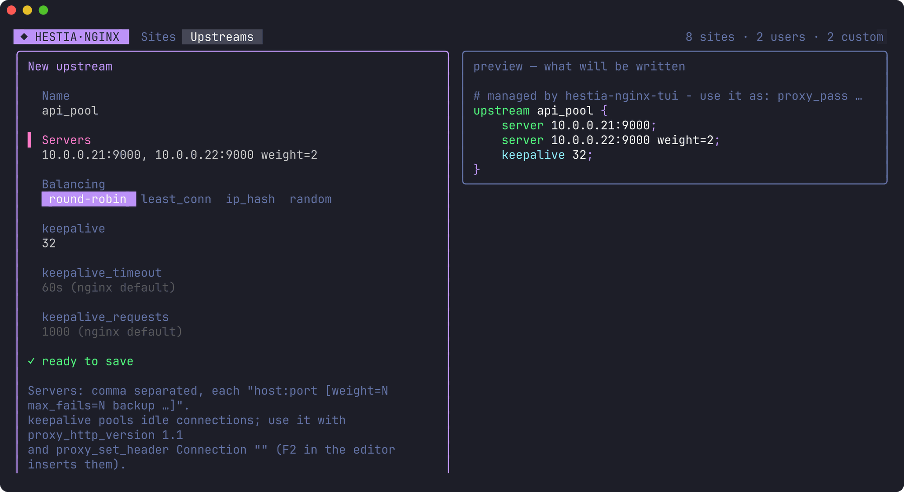
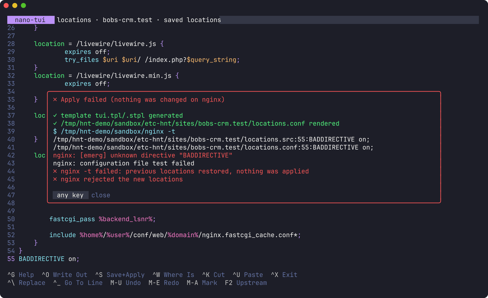

<div align="center">

# ◆ hestia-nginx-tui

**A fast, keyboard-driven terminal UI for managing per-site Nginx config on [HestiaCP](https://hestiacp.com).**<br>
Fuzzy-find any site on any account, give it its own custom `location` blocks, and define reusable upstreams — all with automatic `nginx -t` validation and rollback.

[](https://github.com/onlinedigital/hestia-nginx-tui/releases/latest)
[](https://github.com/onlinedigital/hestia-nginx-tui/actions/workflows/ci.yml)
[](LICENSE)




</div>

---

## Why

HestiaCP generates every vhost from stock templates (`laravel.tpl`/`laravel.stpl`, `wordpress.tpl`, …). Those files are
overwritten on updates and rebuilds, so "just edit the template" is a trap — and copying a template per customer
doesn't scale. **hestia-nginx-tui** gives every site its own editable Nginx snippet **without ever touching a stock
template**, and applies it through Hestia's own `v-change-web-domain-tpl`, so Hestia stays the source of truth.

## Features

- 🔎 **Fuzzy finder** over *all sites of all users* (own implementation, no `fzf` dependency) — multi-term, smart-case, match highlighting. `bob tui` finds the sites of user *bob* that use the `tui` template.
- 🧩 **One template for everything:** a generated `tui.tpl` / `tui.stpl` pair that only contains the fixed Hestia skeleton and a single `include` of the site's own file. You come from `laravel`, `wordpress` or anything else — the site's locations are **pre-filled from the template it had**.
- ✏️ **Built-in editor with nano keys and mandatory soft word-wrap** (`↪` marks continuations), nginx syntax colouring, undo/redo, search/replace, marks, cut/paste — or launch **real `nano`** inside the same terminal.
- 🔁 **One file, both protocols:** HTTP (`.tpl`) and HTTPS (`.stpl`) include the same `locations.conf`, so you edit once.
- 🛡️ **Safe by construction:** every apply runs `nginx -t` first and **rolls back automatically** (rendered file *and* template) if nginx complains. Your text is never lost: it stays saved, with the last 20 versions in `history/`.
- 🔀 **Upstream manager:** create `upstream` blocks with `ip:port`, weights, balancing method and `keepalive`; reference them from any `location`. Nothing is locked — unknown directives survive the form, and a raw editor edits the full text.
- ⚡ **Self-updating:** `Ctrl+U` in the TUI (or `hestia-nginx-tui update`) pulls the latest GitHub release, verifies its sha256 and swaps the binary atomically.
- 🖱️ Mouse wheel and click support, responsive layout down to ~80 columns.

## Install

One line, as root (downloads the latest release for your CPU, verifies the checksum, installs to `/usr/local/bin`):

```sh
curl -fsSL https://raw.githubusercontent.com/onlinedigital/hestia-nginx-tui/main/install.sh | sudo bash
```

Then run it **as root** (it calls Hestia's `v-*` commands and writes under `/etc` and the template directory):

```sh
sudo hestia-nginx-tui
```

<details>
<summary>Installer options, manual install, build from source</summary>

**Installer environment variables**

| Variable | Meaning |
|---|---|
| `VERSION=v1.2.3` | install a specific release instead of the latest |
| `INSTALL_DIR=/path` | target directory (default `/usr/local/bin` as root, `~/.local/bin` otherwise) |

```sh
curl -fsSL https://raw.githubusercontent.com/onlinedigital/hestia-nginx-tui/main/install.sh | sudo VERSION=v0.1.0 bash
```

**Manual install** — pick `linux_amd64` or `linux_arm64` from the [latest release](https://github.com/onlinedigital/hestia-nginx-tui/releases/latest):

```sh
tar -xzf hestia-nginx-tui_*_linux_amd64.tar.gz hestia-nginx-tui
sudo install -m 0755 hestia-nginx-tui /usr/local/bin/
```

**From source** (Go ≥ 1.24)

```sh
git clone https://github.com/onlinedigital/hestia-nginx-tui && cd hestia-nginx-tui
make build && sudo make install
```
</details>

### Updating

```sh
sudo hestia-nginx-tui update      # or press Ctrl+U inside the TUI
```

The TUI checks for a newer release once at startup (one HTTPS request to `github.com`, silently ignored if offline) and shows
`⬆ vX.Y.Z available · ^U` in the header. Set `HNT_NO_UPDATE_CHECK=1` to disable the check. Updates are verified against the
release's `checksums.txt`; a mismatch aborts and leaves the old binary untouched.

## A tour

### Pick a site, pick an action

`Enter` on any site opens the action menu: change template (stock **or** custom), edit custom locations (built-in editor or real nano), view the config Hestia generated, re-apply, or re-seed from another template.



### Edit locations with nano keys and soft wrap

Everything site-specific — `root`, `index`, every `location`, any extra directive — lives in one file. `^S` saves **and applies**; `^O` lets you choose between *save only* and *save & apply*.



### Use your upstreams from any location

Press `F2` in the editor to insert `proxy_pass` for one of your upstreams — as a single line, with the headers `keepalive` needs, or as a complete `location` block. It is inserted as **plain text**, so you can change anything afterwards.



### Manage upstreams

`Tab` switches to the upstream manager: list, usage ("used by 2 sites"), a live preview, and a form with `ip:port` servers, weights/backup, balancing method and `keepalive`.




### Mistakes can't take your server down

A bad edit is caught by `nginx -t`, everything is put back, nginx keeps serving the previous config, and the error is shown — your text stays in the editor so you can fix it.



## How it works

Hestia builds `nginx.conf` / `nginx.ssl.conf` for a domain from `<templates>/web/nginx/php-fpm/<name>.tpl` (HTTP) and `<name>.stpl`
(HTTPS), replacing placeholders such as `%domain%`, `%home%`, `%user%`, `%backend_lsnr%`. This tool generates exactly **one**
custom template pair, `tui.tpl` and `tui.stpl`, whatever template the site came from:

```
 stock template (laravel, wordpress, …)                  /etc/hestia-nginx-tui/sites/<domain>/
 ┌──────────────────────────────┐   pre-fill (once)      ┌──────────────────────────────┐
 │ listen / server_name / logs  │ ─ ─ ─ ─ ─ ─ ─ ─ ─ ─ ▶ │ locations.src   ← you edit   │
 │ ssl_*, anti-replay, includes │   root, index,         │   root, index, location …    │
 │ root, index, location …      │   locations, …         │   (with %placeholders%)      │
 └──────────────────────────────┘                        │ locations.conf  ← rendered   │
                                                         │ history/        ← last 20    │
 tui.tpl / tui.stpl  (identical for every site)          └──────────────────────────────┘
 ┌──────────────────────────────┐                                    ▲
 │ listen / server_name / logs  │                                    │ include
 │ ssl_*, anti-replay, includes │                                    │
 │ include …/%domain%/locations.con[f];  ────────────────────────────┘
 │ /error/ and /vstats/ (Hestia)│
 └──────────────────────────────┘
```

- **The skeleton** (`listen`, `server_name`, access/error logs, `ssl_certificate*`, anti-replay, HSTS / force-SSL / phpMyAdmin / `nginx.conf_*` includes, `/error/`, `/vstats/`) is derived from the `default` template installed on *your* Hestia, so it always matches your version.
- **Everything site-specific** (`root`, `index`, all other `location`s and directives) is extracted from the site's *current* template the first time you customise it, and written to `locations.src`.
- `locations.src` may contain Hestia placeholders. On apply it is rendered to `locations.conf` with real values (`%backend_lsnr%` is read from the site's PHP-FPM pool, `%docroot%`, `%home%`, …).
- The include is `locations.con[f]` — a glob that matches exactly `locations.conf`. Nginx ignores a glob without matches, whereas a missing plain `include` would make `nginx -t` fail for **every** site on the server.

### What "Save & Apply" does

1. save `locations.src` (previous version → `history/`)
2. regenerate `tui.tpl` / `tui.stpl`, render `locations.conf`
3. if the site already uses `tui`: `nginx -t` **before** touching anything
4. `v-change-web-domain-tpl USER DOMAIN tui yes`
5. `nginx -t` again — on failure: restore the previous `locations.conf`, switch the site back to its previous template, report nginx's error

### Files

| Path | What |
|---|---|
| `<hestia>/data/templates/web/nginx/php-fpm/tui.tpl`, `tui.stpl` | generated skeleton (don't edit, regenerated on apply) |
| `/etc/hestia-nginx-tui/sites/<domain>/locations.src` | the file you edit (placeholders) |
| `/etc/hestia-nginx-tui/sites/<domain>/locations.conf` | rendered file that nginx includes |
| `/etc/hestia-nginx-tui/sites/<domain>/base` | stock template the locations were pre-filled from |
| `/etc/hestia-nginx-tui/sites/<domain>/history/` | last 20 saved versions |
| `/etc/hestia-nginx-tui/upstreams/<name>.conf` | one plain nginx file per upstream |
| `/etc/nginx/conf.d/hestia-nginx-tui-upstreams.conf` | `include /etc/hestia-nginx-tui/upstreams/*.conf;` |

## Upstreams

Each upstream is an ordinary nginx file, loaded in the `http {}` context through one glob include:

```nginx
# managed by hestia-nginx-tui - use it as: proxy_pass http://app_backend;
upstream app_backend {
	least_conn;
	server 10.0.0.5:8080 weight=2;
	server 10.0.0.6:8080;
	server 10.0.0.7:8080 backup;
	keepalive 32;
	keepalive_timeout 60s;
}
```

The form covers `ip:port` servers (with `weight=`, `max_fails=`, `backup`, …), the balancing method
(`round-robin` / `least_conn` / `ip_hash` / `random`), `keepalive`, `keepalive_timeout` and `keepalive_requests`.
**It never limits you:** directives the form doesn't know are preserved verbatim, `r` (or `^E` inside the form) opens the
complete text in the editor, and `F2` in the locations editor only *inserts text*. Every save runs `nginx -t`, rolls back
on error and reloads nginx. Deleting an upstream that a location still uses is refused (and rolled back by `nginx -t`).

> `keepalive` to an upstream needs `proxy_http_version 1.1;` and `proxy_set_header Connection "";` in the location —
> the *"proxy_pass + keepalive & proxy headers"* snippet inserts both.

## Keys

<table>
<tr><td valign="top">

**Site list**

| Key | Action |
|---|---|
| *type* | fuzzy search |
| `↑` `↓` `PgUp` `PgDn` | move |
| `Enter` / click | actions for the site |
| `Tab` | upstreams |
| `^R` | reload data |
| `^U` | update the binary |
| `F1` | help |
| `Esc` | clear search |
| `^C` | quit |

**Upstreams**

| Key | Action |
|---|---|
| `n` | new (form) |
| `Enter` / `e` | edit (form) |
| `r` | raw editor |
| `d` | delete |
| `Tab` / `Esc` | back |

</td><td valign="top">

**Editor** (nano keys)

| Key | Action |
|---|---|
| `^O` | write out (save / save & apply) |
| `^S` | **save & apply** |
| `^X` | exit |
| `^W` / `M-W` | search / next |
| `^\` | replace all |
| `^_` / `M-G` | go to line |
| `^K` / `M-6` / `^U` | cut / copy / paste |
| `M-U` / `M-E` | undo / redo |
| `M-A` or `Shift+←→↑↓` | mark / select |
| `^A` `^E` | line start / end |
| `^Y` `^V` | page up / down |
| `Ctrl+←` `Ctrl+→` | word left / right |
| `^C` | cursor position |
| `F2` | insert upstream snippet |
| `^G` | help |

</td></tr>
</table>

## Command line

```text
hestia-nginx-tui            start the TUI (run as root)
hestia-nginx-tui update     update this binary to the latest GitHub release
hestia-nginx-tui render     re-render every custom site's locations.conf and reload nginx
hestia-nginx-tui version
```

Run `render` after changing a site's PHP version in Hestia: `%backend_lsnr%` (the PHP-FPM socket) moves with it.

| Environment variable | Purpose |
|---|---|
| `HNT_NO_UPDATE_CHECK=1` | don't look for a newer release at startup |
| `HNT_EDITOR` | command used instead of `nano` for "edit in nano" |
| `HNT_HESTIA` `HNT_HOME` `HNT_STATE` `HNT_CONFD` `HNT_PHP_DIR` `HNT_NGINX_BIN` `HNT_RELOAD` | path/command overrides (used by the sandbox and tests) |

## Limitations

- Supports `WEB_SYSTEM=nginx` with PHP-FPM (the usual Hestia setup). With Apache behind an nginx proxy the program refuses to start.
- Locations are pre-filled from the stock **`.tpl`**; small `.stpl`-only differences (e.g. `fastcgi_param HTTP_EARLY_DATA`) are not copied, and `proxy_hide_header Upgrade` (HTTPS-only in stock templates) is not applied, which is what you want for WebSocket proxying.
- The shared locations file uses `%docroot%` for `root`. Sites with a separate `public_shtml` (`SSL_HOME=single`) would serve the HTTPS vhost from the HTTP root.
- Stock templates that enable **HTTP/3** (`*-http3`) lose their `quic` listeners when switched to `tui`; the editor warns you.
- When Hestia ships a newer stock `default` template, `tui.tpl`/`tui.stpl` pick it up at the next apply.
- Linux only (amd64, arm64).

## Try it without root or a server

A sandbox builds a fake Hestia (users, real Laravel templates, simulated `v-change-web-domain-tpl` and `nginx -t`):

```sh
make build
eval "$(scripts/sandbox.sh /tmp/hnt-sandbox)" && ./hestia-nginx-tui
```

Type `BADDIRECTIVE` into a location and apply it to watch the rollback.

## Development

```sh
make test                      # go vet + go test ./...
scripts/screenshots.sh         # regenerate docs/screenshots (needs charmbracelet/freeze)
```

Built with [Bubble Tea](https://github.com/charmbracelet/bubbletea), [Lip Gloss](https://github.com/charmbracelet/lipgloss) and [Bubbles](https://github.com/charmbracelet/bubbles). Layout:

```
main.go                  CLI entry point
internal/fuzzy           fzf-style matcher (Smith-Waterman scoring, no dependency)
internal/hestia          sites, templates, rendering, apply + rollback, upstream storage
internal/upstream        upstream model: render/parse without losing directives
internal/tui             screens, popups and the nano-style editor
internal/update          self-update from GitHub releases
```

### Releasing

Pushing a tag builds and publishes everything ([GoReleaser](https://goreleaser.com) via GitHub Actions):
`linux/amd64` and `linux/arm64` archives plus `checksums.txt`.

```sh
git tag v0.2.0 && git push origin v0.2.0
```

## License

[MIT](LICENSE) © OnlineDigital
